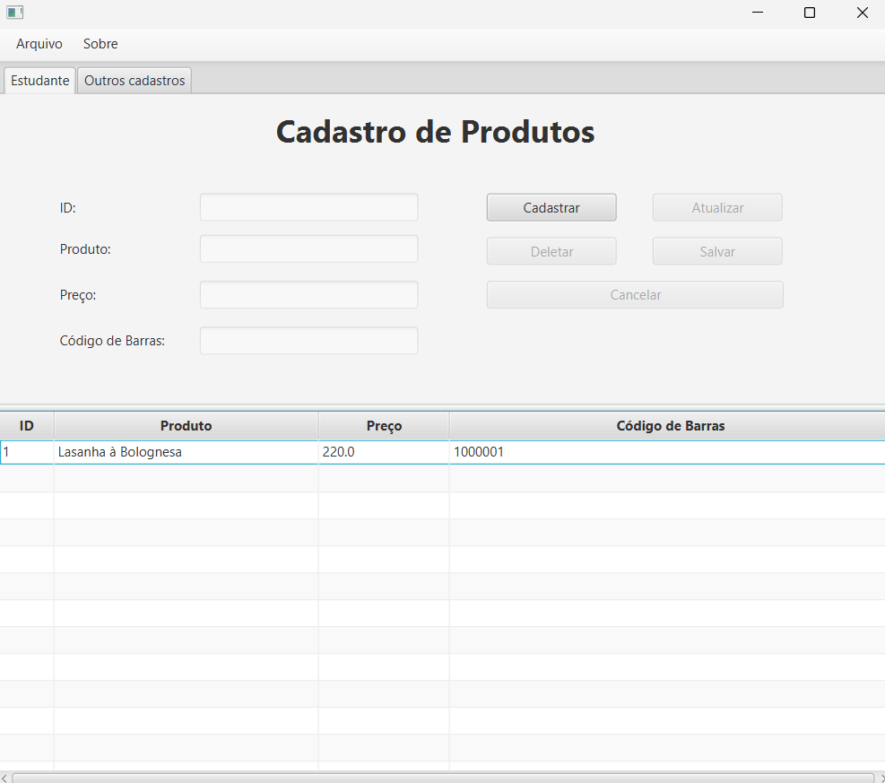
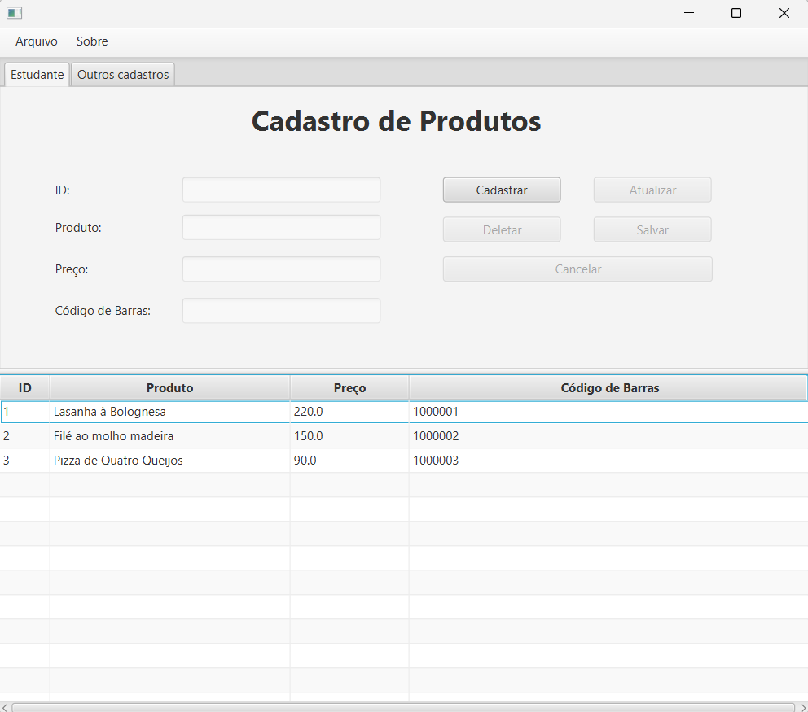
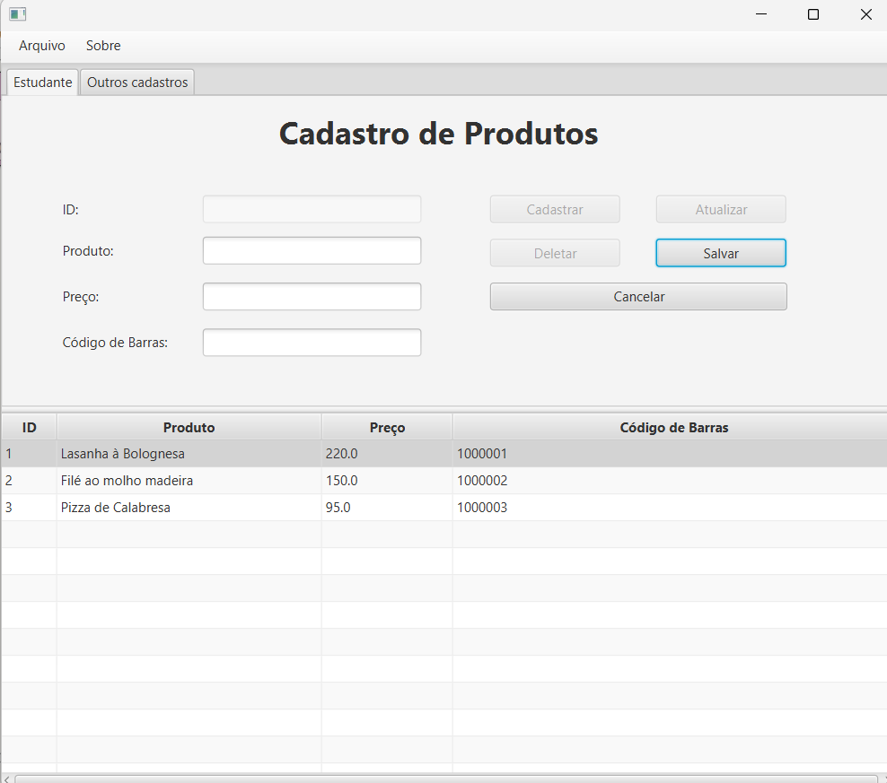

# Sistema de Gerenciamento de Produtos --- JavaFX e Banco de Dados

## 1. Descrição do projeto

Este projeto consiste em uma aplicação gráfica desenvolvida em
**JavaFX** para o gerenciamento de produtos, com persistência de dados
em banco de dados por meio de **ORM**.

A aplicação permite realizar as operações de consulta, cadastro,
atualização e exclusão de produtos. A interface foi organizada seguindo
o padrão arquitetural **MVC (Model-View-Controller)**, separando os
dados da aplicação, a apresentação gráfica e a lógica responsável pelas
ações do usuário.

## 2. Entidade utilizada

A entidade escolhida para a atividade foi **Produto**, que representa os
registros armazenados no banco de dados.

Seus principais atributos são:

-   `id`: identificador do produto;
-   `productName`: nome do produto;
-   `value`: valor do produto;
-   `barCode`: código de barras do produto.

A persistência desses atributos é realizada pela camada ORM utilizada no
projeto.

## 3. Funcionalidades implementadas

A interface gráfica disponibiliza as seguintes operações:

### 3.1. Consulta de produtos (Retrieve)

Os produtos cadastrados no banco de dados são apresentados em uma
`TableView` do JavaFX. A tabela exibe os principais atributos da
entidade, permitindo visualizar os registros armazenados.

### 3.2. Cadastro de produtos (Create)

A interface possui campos de entrada para informar os dados de um novo
produto. Ao acionar a opção de cadastro, os valores preenchidos são
utilizados para criar e armazenar um novo registro no banco de dados.
Após a operação, a tabela é atualizada para apresentar o produto
inserido.

### 3.3. Atualização de produtos (Update)

Também foi implementada a funcionalidade de atualização, que permite
modificar os atributos de um produto já cadastrado. Após selecionar um
registro, seus dados podem ser carregados nos campos de entrada,
editados e salvos. As alterações são persistidas no banco de dados e a
tabela é atualizada para refletir os novos valores.

### 3.4. Exclusão de produtos (Delete)

A aplicação também permite excluir um produto selecionado. A operação
remove o registro do banco de dados e atualiza a tabela para que o
produto excluído deixe de ser exibido.

> **Observação:** conforme o enunciado, as operações obrigatórias da
> atividade são consulta (Retrieve) e cadastro (Create). As
> funcionalidades de atualização (Update) e exclusão (Delete) foram
> implementadas adicionalmente, como recursos complementares.

## 4. Organização da aplicação

O projeto utiliza o padrão **MVC**, distribuindo as responsabilidades
entre as seguintes partes:

-   **Model:** contém a representação da entidade Produto e os dados
    associados a ela.
-   **View:** corresponde à interface gráfica construída com JavaFX,
    incluindo a tabela, os campos de entrada e os botões de operação.
-   **Controller:** recebe as ações realizadas na interface, executa as
    operações correspondentes e coordena a comunicação entre a
    visualização e a camada de persistência.

A camada ORM é utilizada para realizar a comunicação entre os objetos
Java e o banco de dados, permitindo armazenar, consultar, atualizar e
excluir registros.

## 5. Como executar o projeto

1.  Abra o projeto no ambiente de desenvolvimento utilizado.
2.  Verifique se as dependências necessárias, incluindo JavaFX e a
    biblioteca ORM, estão configuradas.
3.  Confira as configurações de conexão com o banco de dados utilizadas
    pela aplicação.
4.  Execute a classe principal responsável por iniciar a interface
    JavaFX.

Após a inicialização, utilize os campos e botões da interface para
consultar, cadastrar, atualizar ou excluir produtos.

## 6. Capturas de tela

As imagens abaixo demonstram a interface e as funcionalidades
implementadas. Adicione as capturas de tela correspondentes na pasta
`imagens` do repositório, utilizando os nomes indicados.

### Interface principal e listagem de produtos

### Cadastro de produto

### Atualização de produto

### Exclusão de produto

## 7. Considerações finais

A atividade permitiu desenvolver uma interface gráfica com JavaFX
integrada a um banco de dados por meio de ORM, aplicando o padrão
arquitetural MVC. Foram implementadas as operações de consulta e
cadastro solicitadas no enunciado e, adicionalmente, as operações de
atualização e exclusão.

Dessa forma, a aplicação oferece as funcionalidades básicas de um
sistema CRUD para a entidade Produto, mantendo a interface e a
persistência dos dados integradas.
